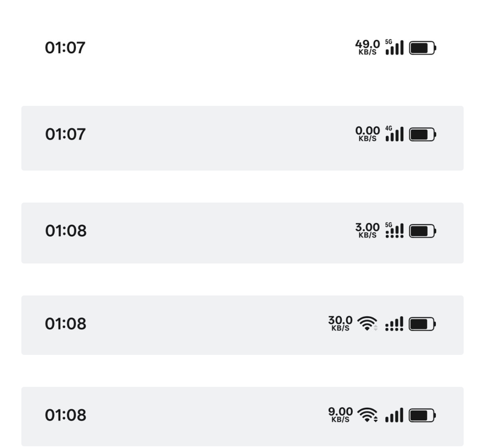

# ColorOS 堆叠信号

把 ColorOS 17 的双排（堆叠）信号样式带到 ColorOS 15 / 16：主卡大信号与副卡小信号叠在同一个槽位，左上角标出当前数据网络制式。

只替换信号图标的绘制内容，不动布局、不新增 view。

从上到下：5G 单卡 / 4G 单卡 / 5G 双卡（下方四点为副卡）/ WiFi 连接 / WiFi 断开

## 特性

- **双卡双排**：主卡大信号 + 副卡四颗小点，占一个图标位
- **单卡满高**：单卡使用专用素材，与状态栏其他图标齐高
- **制式标跟随网络**：2G / 3G / 4G / 5G，WiFi 连接时自动隐藏，左缘与信号柱对齐
- **颜色与系统一致**：转发 `setImageTintList` / `setColorFilter`，通知栏、控制中心、App 内、桌面四处都与电池、网速同色
- **图标间距统一**：信号、WiFi、网速、电池四段视觉间距一致，两端边距左右相同
- **网速刷新 1 秒**：系统原为 4 秒
- **网速数字变宽向左扩展**：右边界固定，位数变化不会推动右侧图标，文字与信号底部齐平
- **尺寸自适应**：随分辨率与显示大小缩放，与同排图标齐高

## 兼容

| 项目 | 说明 |
|---|---|
| 系统 | ColorOS 15 / ColorOS 16（已在 16.99 验证） |
| 框架 | LSPosed（libxposed API 102） |
| 作用域 | 仅 `com.android.systemui`，不注入系统框架 |
| 素材 | 取自 ColorOS 17 状态栏矢量图 |

## 安装

1. LSPosed 安装并启用本模块
2. 作用域勾选「系统界面」（`com.android.systemui`）
3. 重启系统界面

## 说明

- 状态栏原有的小制式图与上下行箭头会被隐藏，制式标改由模块绘制在信号左上角
- WiFi 图标保持系统原生，交回系统绘制，避免主题切换时颜色不同步
- 网速周期通过 Handler 排期拦截实现；若系统改用非 Handler 定时，该功能会失效
- 网速周期为 1 秒：该系统按 4 秒窗口做差分计算，窗口更短会读到瞬时 0 而显示 0.00 K/s
