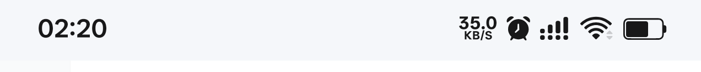
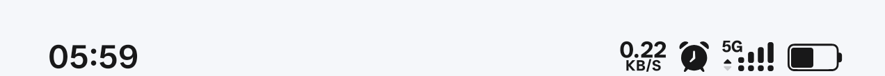

# ColorOS 堆叠信号

在 ColorOS 15 / 16 上还原 ColorOS 17 的双排信号样式：主卡大信号与副卡小信号叠在同一个图标位里，左上角标出当前网络制式。

模块只作用于状态栏的信号图标本身——替换它的绘制方式、调整它在图标行里的位置与间距，其余图标交还给系统。

## 关于这个样式

ColorOS 16 的信号图标是单排的：双卡时两个图标并排、各占一格，状态栏很容易显得拥挤。ColorOS 17 改成一个图标位内的大 + 小堆叠，观感干净不少。

这个模块把那种排布搬到 15 / 16，并理顺状态栏里几处长期不协调的地方：图标顺序、间距、网速的刷新与对齐。

从上到下：5G 单卡 / 4G 单卡 / 5G 双卡（下方四点为副卡）/ WiFi 连接 / WiFi 断开

## 特性

### 信号

- **双卡双排**：主卡大信号 + 副卡四颗小点，共用一个小图标位
- **单卡满高**：只有一张卡时自动换成满高素材，与相邻图标齐高
- **跟随上网卡**：双卡的大图始终是当前正在使用流量的那张卡，切换数据卡后即时重排
- **制式标跟随网络**：2G / 3G / 4G / 5G / 5GA，五种制式等高绘制，WiFi 连接时自动隐藏
- **制式标独立绘制**：不塞进信号图标内部，左缘可与下方网络指示器精确对齐
- **网络指示器下移**：上下行箭头压到格子底部、与信号柱齐平，单双卡按柱高比例自适应

### 状态栏

- **图标顺序对齐 ColorOS 17**：网速 → 信号 → WiFi → 电池
- **图标间距统一**：左右 padding 归零、等宽留白，图标增多减少都不会重排
- **网速改为真实字节数**：按实际收发的字节与真实时间差计算速率，仅统计物理出口网卡（`wlan0` / `rmnet_data*` / `eth*`）。不使用系统总流量统计——走 VPN 或代理时同一份数据会经过两个接口，用总流量会被算两遍
- **网速刷新 1 秒**：系统原为 4 秒
- **网速向左扩展**：右边界固定，位数变化不推动右侧图标，文字与信号底部齐平
- **颜色与系统一致**：通知栏、控制中心、App 内、桌面四处都与电池、网速同色
- **下拉通知栏保持原厂**：展开时模块不做任何改动

### 通用

- **尺寸自适应**：随分辨率与显示大小缩放，与同排图标齐高

## 兼容

| 项目 | 说明 |
|---|---|
| 系统 | ColorOS 15 / ColorOS 16（已在 16.99 验证） |
| 框架 | LSPosed（libxposed API 102） |
| 作用域 | 仅 `com.android.systemui` |
| 素材 | 取自 ColorOS 17 状态栏矢量图 |

## 已知问题

- **蓝牙图标显示混乱**。由于暂时没有蓝牙耳机，无法复现与验证，尚未修复。
- **5GA 制式可能显示为 5G**。由于所在地区暂无 5GA 网络，无法测试，判定逻辑未经实测。

## 安装

1. 在 LSPosed 中安装并启用本模块
2. 作用域勾选「系统界面」（`com.android.systemui`）
3. 重启系统界面生效

不需要重启整机。

## 实现说明

展开查看技术细节

- 替换 `mobile_signal` 这个 ImageView 的 drawable，主副卡与制式标全部画在同一张 drawable 内，不往容器里插入视图
- 副卡那一份视图被收起时只压宽度、不改高度——改高度会让 `wrap_content` 的父链路重新测量，信号柱会整体偏移
- 切换数据卡时按当前数据卡判定主副卡，并监听系统广播即时重算，不依赖轮询
- 图标顺序通过重排 `config_statusBarIcons` 数组实现，纯数据层，不触碰视图树
- 网速由 `NetworkSpeedIconState.getSpeedText()` 返回自己算的值，单位换算与小数位仍归原厂
- 制式标为独立 TextView，挂在信号容器上，颜色取同排 ImageView 的 tint

## 更新日志

**1.1.1**
- 修复切换当前上网卡时状态栏图标混乱、错位或消失的问题。

**1.10**
- 制式标改为独立视图，可与网络指示器左缘精确对齐。
- 网络指示器整体下移，与信号柱底部齐平，单双卡按柱高比例自适应。
- 进入下拉通知栏时保持系统原厂行为，模块不做任何修改。
- 清理失效引用与遗留注释。

**1.9**
- 优化网速统计逻辑，改为按真实字节数计算。
- 仅统计物理出口网卡，提升网速数据的真实性与准确性。
- 恢复 Wi-Fi 网络指示器显示，移动数据指示器保持隐藏。
- 清理死代码与过期资源，精简冗余内容。

**1.8**
- 修复蓝牙图标异常显示的问题

**1.7**
- 收缩所有图标整体间距
- 网速始终保持在最左边

**1.6**
- 状态栏图标顺序对齐 ColorOS 17：网速 → 信号 → WiFi → 电池

**1.5**
- 状态栏两端外扩幅度减半：右侧内边距回收 8dp → 4dp，两端差值只补一半
- 时钟不再被挤到边上，较长的时间文字也能完整显示

**1.4**
- 网速数字改为向左扩展，右边界固定，位数变化不再推动右侧图标
- 网速文字与信号底部对齐，刷新周期 4 秒 → 1 秒
- 制式标左缘与信号柱对齐

**1.3**
- 信号、WiFi、网速、电池四段视觉间距统一，两端边距左右相等

**1.2**
- 双卡双排、单卡满高两种布局自动分流
- 制式标跟随 2G / 3G / 4G / 5G 自动切换，WiFi 连接时隐藏

**1.0**
- 首个可用版本：主卡大信号 + 副卡小信号叠在同一槽位

---

## 说明

- 状态栏原有的小制式图会被隐藏，制式标改由独立视图绘制在信号格内
- 上下行箭头保留，整体下移与信号柱底部齐平
- 下拉通知栏内的一切保持系统原厂，模块不做任何改动
- WiFi 图标保持系统原生，交回系统绘制，避免主题切换时颜色不同步
- 网速周期通过 Handler 排期拦截实现；若系统改用非 Handler 定时，该功能会失效
- 网速周期为 1 秒：该系统按 4 秒窗口做差分计算，窗口更短会读到瞬时 0 而显示 0.00 K/s
